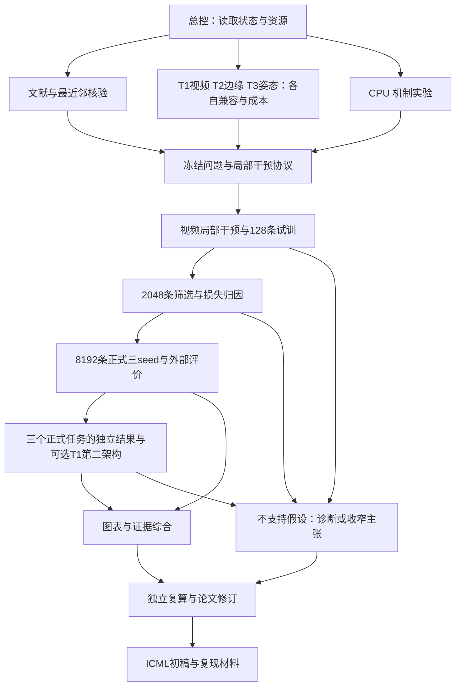

# 多任务路线与交接

建议使用一个总控，维护少数持续角色；同一角色在后续阶段接续不同 prompt，避免一次建立十几个闲置聊天。是否使用独立聊天或短 subagent 取决于运行时工具与用户在启动 prompt 中给出的授权。下图是依赖关系，不是已执行状态。

| 持续角色 | 建议接续的角色 prompt | 工作独占范围 | 开始条件 |
|---|---|---|---|
| 总控 | 00、13、15 | state、派工、资源、跨包合并 | 接收者发送主启动 prompt |
| 文献/研究 | 02、04、06 | literature、自有机制代码与 reports | 无 GPU 可先文献与 CPU 工作 |
| 工程/训练 | 03、05、07、09、14 | 经分配的 src/configs、数据版本、独立 runs | GPU任务先有租约与阶段门 |
| 评价/图表 | 08、10 | evaluation、figures、tables、reports | 协议先行，实测输入到位后填数字 |
| 论文/独立审查 | 11、12 | paper；审查写单独 reports | 可先写无结果稿；审查者尽量独立于被审实现 |

同一人可以合并角色；独立审查应保留一个未实现被审部分的上下文。正式训练队列可串行，不要求多个 GPU 或特定厂商；不要把多个聊天数量当成可用算力。

遇到停机/中断，先用 13 接管状态和真实 job；错误用 14 诊断。每一轮以文件记录作为交接依据，不依赖聊天记忆或只剩截图的结果。

当前正式范围为T1身份视频、T2 Canny图像、T3人体姿态图像。上图每条实验链在各任务内适用，三个任务的准备可并行、GPU按共享租约排队；某任务出现负结果不阻止其他任务独立推进。T2/T3具体派工入口为prompts/16和17，均不是可选第二任务。
